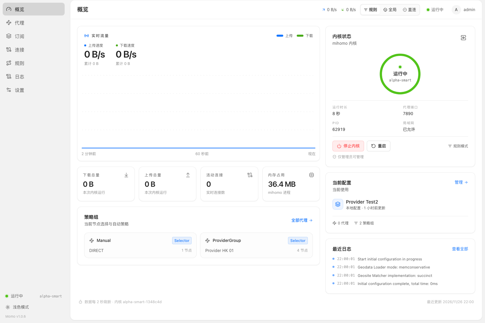
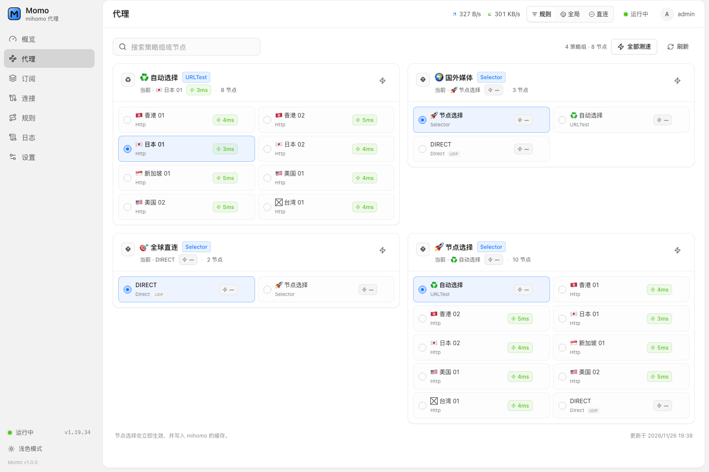
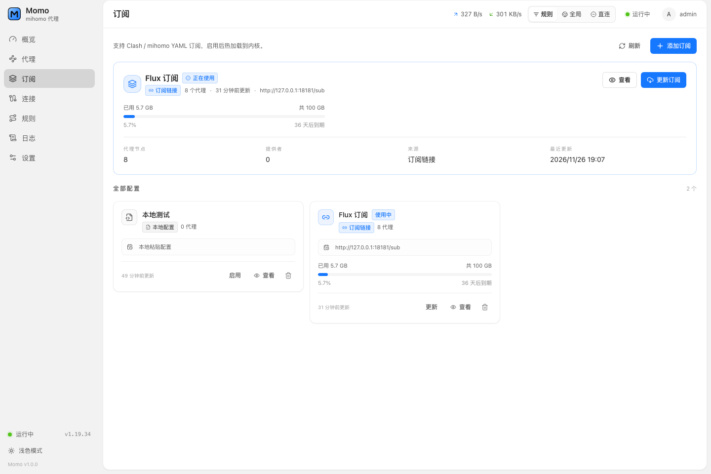
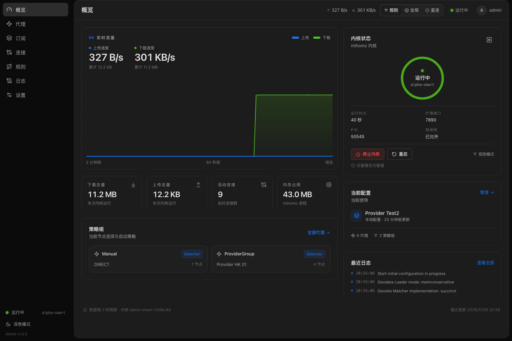
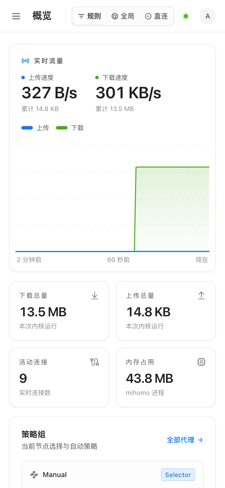

# Momo

基于 **mihomo** 内核的飞牛 fnOS 原生代理应用。

Momo 以 fnOS Native 进程方式运行：Node.js 后端托管 mihomo、管理订阅与配置，前端通过飞牛统一网关提供代理面板。窗口外壳、侧边栏和主题遵循飞牛原生应用风格，并接入 `@trimjs/web-app` 跟随宿主深浅色主题；页面布局参考 [zashboard](https://github.com/Zephyruso/zashboard)。



| 代理 | 订阅 |
| --- | --- |
|  |  |

| 深色主题 | 移动端 |
| --- | --- |
|  |  |

## 功能

- **内核托管**：使用 vernesong/mihomo 的 **smart 内核**（含 LightGBM 模型）；支持启动、停止、重启，异常退出后按退避策略重启，日志写入应用数据目录。
- **订阅管理**：支持订阅链接、粘贴 YAML、导入文件；自动识别 Base64 订阅、`subscription-userinfo` 流量与到期信息；可设置自动更新间隔并一键更新全部订阅。
- **代理选择**：策略组、节点延迟测速、节点切换、代理提供者更新与健康检查。
- **实时观察**：流量曲线、连接列表（含详情弹窗）、规则命中、内核日志，支持筛选与关闭连接。
- **配置编辑**：代理端口、局域网访问、IPv6、模式、日志级别、统一延迟、TCP 并发、DNS 监听端口/上游。
- **透明代理**：TUN（gVisor/System/Mixed、自动路由、DNS 劫持）和 Redir（nftables 接管本机 TCP + DNS）两种模式，默认关闭。
- **备份恢复**：导出包含设置和全部订阅内容的 JSON 备份，可在重装后恢复。
- **原生外观**：200px 侧边栏、悬浮圆角内容面板、Ant Design 风格配色，自动跟随 fnOS 明暗主题。
- **权限分层**：应用主进程以 root 管理网络，mihomo 子进程降权到专用 `momo` 用户；控制器只监听 `127.0.0.1`，面板仅管理员可访问。

## 架构

```text
飞牛桌面 / 浏览器
      │  /app/momo（统一网关，校验 NAS 登录态）
      ▼
${TRIM_APPDEST}/app.sock（Unix Socket，660）
      │
Node.js 后端（Express）
      ├── 静态前端（React + Vite）
      ├── REST API / 订阅与配置存储
      └── 127.0.0.1:<随机端口>（Bearer Secret）
                │
               mihomo 内核 ── 混合代理 0.0.0.0:7890（可配置）
```

- 应用包名：`momo`
- 数据目录：`${TRIM_PKGVAR}`（通常是 `/vol1/@appdata/momo`）
- 管理入口：`/app/momo`，仅管理员可见
- 默认代理端口：`7890`（HTTP + SOCKS5 混合端口）
- 内核：Mihomo Meta `alpha-smart-1348c4d`（[vernesong/mihomo](https://github.com/vernesong/mihomo) 的 smart 分支），随包附带 LightGBM 模型与 ASN 数据库

## 目录结构

```text
.
├── backend/                 Node.js 后端（Express、YAML、mihomo 管理）
├── frontend/                React + Vite + Tailwind 前端
├── packaging/               fnOS 应用包模板
│   ├── manifest
│   ├── config/{privilege,resource}
│   ├── cmd/                 生命周期脚本
│   ├── app/ui/              桌面入口与图标
│   └── wizard/              安装/卸载/配置向导
├── scripts/
│   ├── fetch-core.mjs       下载并校验 smart 内核 / 模型 / 地理数据库
│   ├── build.mjs            构建前端并产出 x86/arm FPK
│   └── make-icons.py        生成应用图标
├── vendor/                  依赖二进制（不提交，按脚本下载）
└── dist/                    构建产物
```

## 安装

要求：

- 飞牛 fnOS `>= 1.1.3100`（统一网关）
- 商店依赖 `nodejs_v24`（manifest 中已声明，安装时自动处理）
- 按设备架构选择 FPK：
  - x86 设备：`dist/momo_1.0.9_x86.fpk`
  - ARM 设备：`dist/momo_1.0.9_arm.fpk`

安装步骤：

1. 打开飞牛「应用中心」→ 左下角手动安装 → 选择对应架构的 `.fpk`。
2. 安装完成后启动 Momo，在桌面或应用中心打开。
3. 首次打开没有配置，进入「订阅」添加 Clash / mihomo 订阅链接，或直接粘贴 YAML。
4. 启用配置后，在「设置」确认代理端口；局域网设备将代理地址设置为 `http://<NAS 地址>:<端口>`（默认 7890），HTTP 与 SOCKS5 共用该端口。

> 仓库中的 FPK 使用 `--nosign` 构建，仅用于本地安装测试。正式分发前需要导入飞牛开发者证书并重新构建，见下文「签名」。

## 构建

### 1. 准备依赖

```bash
npm run install:all        # 安装前后端依赖
npm run fetch:core         # 下载并校验 smart 内核、LightGBM 模型与 geo 数据
```

安装 `fnpack`（飞牛官方打包工具，1.3.3）：

```bash
# macOS Apple Silicon 示例，其他平台见飞牛开发文档
curl -fL -o fnpack https://static2.fnnas.com/fnpack/fnpack-1.3.3-darwin-arm64
chmod +x fnpack
sudo mv fnpack /usr/local/bin/fnpack
fnpack --help
```

### 2. 打包

```bash
npm run build
# 或只打一个架构
node scripts/build.mjs --arch=x86
```

产物：

```text
dist/momo_1.0.9_x86.fpk
dist/momo_1.0.9_arm.fpk
dist/SHA256SUMS
```

构建脚本会：

1. 构建前端到 `frontend/dist`；
2. 按架构准备 smart 内核、LightGBM 模型与地理数据库；
3. 组装 `packaging/`、后端源码与生产依赖；
4. 调用 `fnpack build` 打包并校验内核/地理数据 SHA-256。

### 3. 签名

未签名包只能本地调试。使用飞牛开发者证书签名：

```bash
fnpack cert import -key ./developer.key -crt ./developer.crt
node scripts/build.mjs --sign
```

## 本地开发

```bash
# 终端 1：后端，监听 127.0.0.1:5001，允许无网关头访问
npm run dev:backend

# 终端 2：前端 Vite
npm run dev:frontend
```

打开 `http://localhost:5173/app/momo/`。后端在开发模式下使用 `vendor/` 中的 macOS mihomo 二进制和 `dev-data/` 数据目录。

运行后端测试（包含真实 mihomo 启动测试）：

```bash
npm test
```

## 使用说明

### 订阅

- 订阅链接：后端以 mihomo User-Agent 拉取，识别 Base64 编码和 `subscription-userinfo`。
- 粘贴/导入：支持 Clash / mihomo YAML，保存前会调用 `mihomo -t` 校验。
- 更新订阅：仅链接订阅可更新；更新后如果该配置正在使用，会热重载内核，失败时自动重启恢复。
- 删除正在使用的配置：内核切换到最小直连配置。

### 代理

- Selector / Fallback 组可点击切换节点；URLTest / LoadBalance 由内核自动选择。
- 节点卡片右侧闪电按钮测单个节点；组标题闪电按钮测试组内全部节点（分批执行）。
- 测速 URL 默认 `https://www.gstatic.com/generate_204`。
- 切换节点会写入 mihomo 的 `store-selected` 缓存，内核重启后保持。

### 设置与安全

- 端口修改会重启内核，当前连接会中断。
- 「规则 / 全局 / 直连」模式切换使用 mihomo 控制器热更新，不重启。
- 管理面板只允许 fnOS 管理员访问；后端会校验 `X-Trim-Isadmin`，写操作还要求自定义请求头防止 CSRF。
- mihomo 控制器绑定随机 `127.0.0.1` 端口，Secret 仅保存在内存和 `config.yaml` 中，不下发前端。
- 统一网关 Socket 权限为 `660`，非应用用户无法直接连接。

## 与 ShellCrash 的功能取舍

参考 NAS 上 ShellCrash 的能力，Momo 已经吸收：

- 订阅自动更新与全部更新
- 一键启动/停止/重启内核
- 备份与恢复
- 代理端口、DNS 端口与 DNS 上游设置
- 代理提供者批量更新

已提供 TUN 和 Redir（TCP + DNS）透明的可选模式。以下能力仍未纳入：TPROXY、防火墙/端口转发、DDNS、Telegram Bot、内核自更新。内核自更新不做是避免绕过应用中心签名与版本管理；其余属于后续功能路线。

## 已知限制

- 应用以 **root** 运行（`config/privilege run-as: root`），以便 Redir 模式通过 nftables 接管网络；mihomo 子进程会降权到 `momo` 用户运行，并通过文件 capability 获得 TUN 所需网络能力。请只在信任的应用环境安装。
- TUN/Redir 为**可选功能**，默认关闭。开启后会影响整个 NAS 的网络出口，请确认可承受断网风险。
- 订阅配置中的 `dns.listen` 会被应用设置中的 DNS 端口覆盖（默认 `1053`），避免 package 用户无法监听 53 等特权端口；可在设置中修改 DNS 上游。
- 切换订阅不做完整的 `mihomo -t` 预校验，避免订阅内 provider 网络拉取导致切换超时；配置写入后由 mihomo 热重载或重启直接应用，失败会回滚到原配置并在界面显示错误。
- 订阅下载依赖 NAS 自身能访问订阅地址；如果订阅地址只能通过代理访问，请先粘贴配置。
- 未签名 FPK 只适合本地安装测试，正式发布需开发者证书。
- 面板需要管理员权限，不支持多用户隔离。

## API

所有接口位于 `/app/momo/api`，需要网关管理员身份；非 GET 请求需要 `X-Momo-Request: 1`。

| 方法 | 路径 | 说明 |
| --- | --- | --- |
| GET | `/status` | 内核、设置、当前配置、流量概览 |
| GET/PATCH | `/settings` | 读取/更新设置（更新会重启内核） |
| GET | `/status` | 包含 `tunCapable`、`rootMode`、`transparentActive` 状态 |
| POST | `/core/mode` | 切换规则/全局/直连模式 |
| POST | `/core/start` `/core/stop` `/core/restart` `/core/reload` | 启动 / 停止 / 重启内核 / 热重载配置 |
| GET | `/traffic` `/connections` | 流量曲线 / 连接列表 |
| GET | `/proxies` `/rules` `/providers` | 代理、规则、提供者 |
| POST | `/proxies/select` `/proxies/delay` | 选择节点 / 延迟测速 |
| GET/POST | `/profiles` | 列出 / 添加配置 |
| POST | `/profiles/:id/activate` `/update` | 启用 / 更新订阅 |
| POST | `/profiles/update-all` | 更新全部链接订阅 |
| POST | `/providers/update-all` | 更新全部代理提供者 |
| GET | `/backup` | 导出设置与全部订阅 |
| POST | `/restore` | 恢复备份 |
| GET | `/logs` | 增量日志 |

## 代码说明

- 后端入口 `backend/src/index.js`，业务编排在 `backend/src/service.js`，mihomo 进程管理在 `backend/src/core.js`。
- 配置合并/覆盖（端口、DNS、控制器等）在 `backend/src/config-builder.js`。
- 生命周期脚本在 `packaging/cmd/`；统一网关与桌面入口在 `packaging/app/ui/config`。
- 前端 `AppContext` 负责轮询、主题与 API 状态；`Layout` + `Sidebar` + `Topbar` 实现 fnOS 原生窗口壳。

## 致谢

- [mihomo](https://github.com/MetaCubeX/mihomo)（GPL-3.0）：代理内核与 Clash API。
- [zashboard](https://github.com/Zephyruso/zashboard)（MIT）：代理面板布局与交互参考。
- [MetaCubeX/meta-rules-dat](https://github.com/MetaCubeX/meta-rules-dat)：随包分发的 GeoSite / GeoIP 数据。
- [飞牛 fnOS 开发者文档](https://developer.fnnas.com/)：Native 应用、统一网关与生命周期规范。

## License

Momo 自身代码以 MIT 发布。分发包内的 mihomo 内核为 GPL-3.0，详见 [THIRD_PARTY_NOTICES.md](THIRD_PARTY_NOTICES.md)。
